# Developer World

**Your GitHub contribution calendar, reimagined as a miniature living world.** Every day is a tile. Contributions grow islands, gardens, homes, workshops and landmarks without changing the familiar 53-week × 7-day shape.

> **Status: public, early-access source project.** Both worlds, GitHub contribution collection, static SVG exports and a browser-generated GIF work. The visual separation of low and high contribution days is a known design issue under improvement. There is no published npm package or production release.

## See the worlds

| The Isles of Code: archipelago | The Little Buildtown: village |
| :---: | :---: |
|  |  |
| [Light archipelago](previews/real-archipelago-light.svg) · [Motion-free archipelago](previews/real-archipelago-still.svg) | [Dark village](previews/real-village-dark.svg) |

The initial images are a publicly visible snapshot of **the maintainer's account, AdityaSreevatsaK**, not data generated for visitors. **You can create a world from your own GitHub account** by following the instructions below. Generated statistics are truthful to the source's scope and collection date; they are never a live-updating page view.

## Run locally

Requires **Node.js 22+** and Git. The core application has **no third-party runtime dependencies**. Modern Chromium is needed only to export animated GIFs and for the optional browser integration test.

~~~powershell
git clone https://github.com/AdityaSreevatsaK/Developer-World.git
cd Developer-World
npm test
npm run preview
~~~

Open **http://127.0.0.1:8787/**. Select **Archipelago** or **Village**, switch themes, inspect days, replay the timeline, upload a compatible JSON snapshot, or download SVG and GIF exports.

### Render your actual GitHub contributions

The official contribution calendar requires a GitHub token for GraphQL. **Never paste tokens into source code or commit them.** Use an environment variable.

~~~powershell
$env:GITHUB_TOKEN = "YOUR_GITHUB_TOKEN"
node collect-github.cjs --login YOUR_GITHUB_USERNAME
node publish-real.cjs --login YOUR_GITHUB_USERNAME
npm run preview
~~~

The updated browser defaults to \`real-activity.json\` from your local checkout. To export static SVGs to \`exports/\`:

~~~powershell
node export.cjs --input real-activity.json
~~~

For the simplest automated experience, **fork this repository**, go to **Settings → Actions → General** to enable Actions and allow workflow writes as appropriate, optionally configure repository variable \`DEVELOPER_WORLD_USERNAME\` to another GitHub account, and run **Actions → Refresh real contribution previews → Run workflow**. This workflow can also refresh on its daily schedule on the default branch when enabled. In the fork, the default target is your repository owner. See [automation setup](docs/AUTOMATION.md).

**Security note:** The default GitHub Actions token can read public contribution information. It does not guarantee that private contributions appear. Workflows intentionally publish only GitHub-visible data and partial public event details. No secrets are added to generated files.

## How it works

- **Daily GitHub counts:** \`contributionsCollection.contributionCalendar\` is the authority for total and daily **visible contributions**.
- **Recent event decorations:** GitHub's public REST event feed supplies a partial list of named repositories and event types. It **must not** be added to the GraphQL contribution totals or presented as a full year's event history.
- **Two distinct worlds:** Archipelago and village use exactly the same dates and data.
- **Four visual growth tiers:** GitHub's NONE/FIRST/SECOND/THIRD/FOURTH_QUARTILE data determines intensity. Stronger silhouette separation across tiers is planned.
- **Timeline:** The animation reveals **real recorded calendar dates**, never invented activity.
- **Real vs demo:** Synthetic examples are always labelled. The default preview uses real data only when present. Missing real data is reported, never silently substituted with a demo.
- **Exports:** SVG animations may be suppressed by GitHub's image proxy; provide a still SVG for accessibility. The browser can generate a standards-compatible animated GIF locally.
- **Privacy:** Publishing previews and \`real-activity.json\` makes the collected public account metadata visible in your repository. Inspect it before committing to a fork.

## Quick commands

| Command | Purpose |
| --- | --- |
| \`npm test\` | Run deterministic offline unit and integration tests |
| \`npm run preview\` | Start local preview on port 8787 |
| \`npm run export\` | Export fixture-based SVG variants |
| \`npm run collect-real -- --login USERNAME\` | Fetch a GitHub account's visible calendar |
| \`npm run publish-real -- --login USERNAME\` | Create real-account SVG previews |
| \`npm run showcase\` | Print deterministic synthetic showcase JSON |

## Project map

| File or directory | Responsibility |
| --- | --- |
| \`renderer.js\` | Strict snapshot validation, calendar layout, miniature world SVG rendering |
| \`collect-github.cjs\` | Authenticated GraphQL calendar plus partial public REST events |
| \`publish-real.cjs\` | Deterministic real-account SVG exports with account validation |
| \`index.html\` / \`gif.js\` | Browser explorer and no-dependency GIF89a encoder |
| \`export.cjs\` | Offline CLI SVG export |
| \`server.cjs\` | Local-only HTTP preview with guarded file serving |
| \`fixtures/\` | Clearly synthetic reusable fixtures |
| \`real-activity.json\` | Maintainer account's last published public snapshot |
| \`previews/\` | GitHub-readable generated images |
| \`tests/\` | Node unit, CLI, HTTP and Chromium integration checks |
| \`AGENTS.md\` | Mandatory AI-agent maintenance instructions |
| \`docs/\` | Architecture, contracts, automation, security, testing and roadmap |

## Contributing

Issues and pull requests are welcome. Read [CONTRIBUTING.md](CONTRIBUTING.md), [AGENTS.md](AGENTS.md), [data contract](docs/DATA_CONTRACT.md) and [security guidance](SECURITY.md). CI uses fixture data only, never a developer's token. Avoid adding mock activity to a real screenshot or implying that GitHub's recent public events are complete historical contributions.

**Licence:** [MIT](LICENSE). This repository is independently maintained, unaffiliated with GitHub, and uses original procedurally generated artwork.

## Roadmap

1. Improve the visual difference between low and high contribution days without distorting recorded GitHub counts.
2. Strengthen responsive readability and reduced-motion presentation.
3. Review GitHub's image-proxy behaviour for GIF and SVG animation.
4. Harden multi-user setup, fork safety and configuration.
5. Prepare a versioned public release after reviews and reproducible checks.

The original early prototype was developed in [GitHub Activity Studio](https://github.com/AdityaSreevatsaK/GitHub-Activity-Studio). **This standalone repository is now the canonical development home.** The Studio's other concepts remain independent.
