# Visual review: contribution intensity redesign

**Status:** Implemented on branch `fix/contribution-intensity-contrast`; pending review and merge. Issue [#1](https://github.com/AdityaSreevatsaK/Developer-World/issues/1).

**Purpose:** Low-numbered contribution days must not resemble high-numbered days when a GitHub profile embeds a 1120×350 miniature-world visualisation at roughly half its native width.

## Actual account, before and after

The two sides represent the **same saved, genuine GitHub account snapshot**. The source is `real-activity.json`, with **1,771 GitHub-visible contributions across 99 active dates** collected on 18 November 2026. These previews have not been padded with synthetic contributions.

### The Isles of Code, dark

| Before (master) | Proposed redesign (this PR) |
| --- | --- |
|  |  |

### The Little Buildtown, light

| Before (master) | Proposed redesign (this PR) |
| --- | --- |
|  |  |

### Other variations

- [New dark village](../previews/real-village-dark.svg)
- [New light archipelago](../previews/real-archipelago-light.svg)
- [New motion-free archipelago](../previews/real-archipelago-still.svg)

**Review these at half-width as well as full-width.** The world still uses all **371** 53×7 calendar slots, including unknown and future dates. Source-backed contribution counts and dates have not changed.

## Explicit art progression

| Verified GitHub level | Archipelago silhouette | Village silhouette | Main visual distinction |
| --- | --- | --- | --- |
| NONE | Quiet water | Empty lot | No buildings or invented activity |
| FIRST_QUARTILE | Tiny sandbar | Single sprout | Very small occupied footprint |
| SECOND_QUARTILE | Vegetated half-tile island | Small single-room cottage | Larger land or roof and wall |
| THIRD_QUARTILE | Developed island with workshop | Taller workshop, chimney and windows | Noticeably taller and denser structure |
| FOURTH_QUARTILE | Full-tile gold-framed citadel, tower and beacon | Full-width gold-framed civic hall and tall tower | Strong outline, larger footprint, maximum height and detail |

GitHub determines the quartile **independently of any fixed local numeric thresholds**. Each day retains its **exact GraphQL `contributionCount`** and `contributionLevel`. More exact contributions in a fixed quartile may add 1–3 small accents, but never promote the day to a higher quartile or imply another GitHub event happened.

## Tests and limits

- Five new deterministic Node tests cover each silhouette and both world variants, real-versus-synthetic labelling, unknown and future cells, exact counts, within-tier accents and chronological animation.
- CI runs all tests, exports and browser GIF smoke on Windows/Ubuntu using **synthetic** test data, without GitHub tokens.
- The feature branch's five real-account **SVG** previews are regenerated from the unchanged verified snapshot. The committed `real-archipelago.gif` still shows the previous generation until the trusted default-branch refresh runs after approval and merge.
- GitHub README image-proxy accessibility and smaller mobile widths still deserve manual review. A visual improvement in GitHub's source viewer does not guarantee all image consumers render CSS-based SVG motion.

## Acceptance checklist

- [x] Real counts and GitHub's official quartiles retained
- [x] Empty/unknown dates never turn into invented structures
- [x] Distinct silhouettes and non-colour cues at every stage
- [x] Both worlds and both themes regenerate deterministically
- [x] Account SVG preview assets refreshed on the feature branch
- [ ] Owner reviews visual results at GitHub profile scale
- [ ] PR merged and trusted refresh regenerates the actual animated GIF
- [ ] Final hosted README/GIF rendering and mobile review

**Do not close Issue #1 until the visual result is accepted and merged.**
